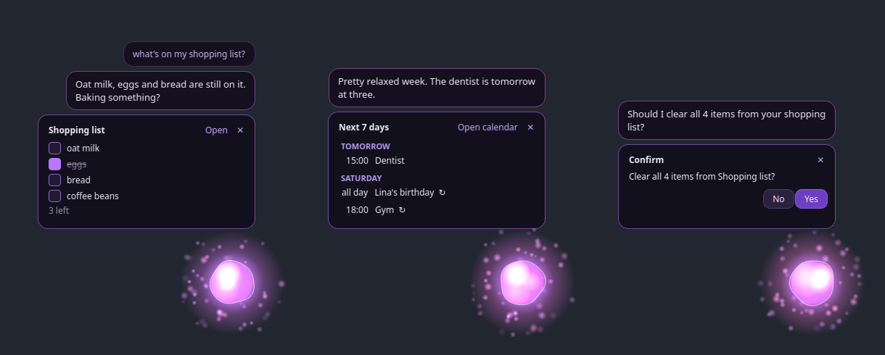

# Aria

Aria ist eine lokale KI-Assistentin für den Schreibtisch: ein animierter 3D-Avatar (im Schlaf eine leuchtende Kugel), die zuhört,
spricht, den Laptop steuert und Notizen, Listen und Kalender in **[MyNotion](https://github.com/ibolawand/MyNotion)**
(meiner Notiz-App) führt. Gespräche, Spracherkennung, Stimme und Kamera laufen lokal. Für ausgewählte Textaufgaben und gemeinsame Gespräche kann Aria optional Claude über das angemeldete Claude-Code-Programm verwenden.


Sie ist als Freundin gedacht, nicht nur als Werkzeug: Sie merkt sich, was man ihr erzählt, reagiert als stiller Avatar auf die Arbeit am Rechner und kann zusammen mit Claude plaudern. Was sie über einen weiß,
steht in einer Notiz in MyNotion, die man selbst bearbeiten kann.



## Was Aria kann

Die vollständige Liste mit allen Details steht in **[BetterAI/FEATURES.md](BetterAI/FEATURES.md)** (Englisch). Kurz:

| Bereich | Beispiele |
|---|---|
| **Gespräche** | Warme, lockere Persönlichkeit; merkt sich Gespräche; optionale Duette mit Claude, spontane Chats außerhalb der Ruhezeiten |
| **Notizen, Listen, Kalender** | „Schreib Eier auf die Einkaufsliste", „ich habe die Miete bezahlt" (hakt ab), „was habe ich morgen?", „Fitness jeden Montag und Donnerstag um 18 Uhr", „öffne meinen Kalender" |
| **Erinnerungen** | „Erinnere mich jeden Tag um 8 an die Vitamine", „am Montag um 10 ans Zugticket" |
| **Laptop** | Jede App aus dem Menü öffnen, Lautstärke und Audioausgang, Medien, WLAN/Bluetooth, Sperren, Akku und Temperaturen |
| **Dateien** | Nach Namen *und* Inhalt suchen („das PDF über Zahnradgetriebe"), vorlesen, zusammenfassen und als Notiz speichern, Downloads aufräumen |
| **Bildschirm & Kamera** | „Was ist das für ein Fehler auf meinem Bildschirm?", Gesichter erkennen, merken, wann man am Platz ist |
| **Wissen** | Websuche über Wikipedia und eine eigene SearXNG-Suchmaschine (ohne Konto oder API-Schlüssel) |
| **Musik** | Spotify: Lieder, Künstler, Playlists, Genres |

Riskante Aktionen (Apps schließen, Herunterfahren, Termine löschen …) fragen immer erst nach, und das „Ja" wird im
Code geprüft, nicht vom Sprachmodell. Das Modell bekommt nie eine Shell.

## Aufbau

```
Sprache (faster-whisper) ─┐                    ┌─ Stimme (Kokoro, CPU)
Text (Overlay, Hotkey) ───┼─► main.py ─► Ollama qwen3:30b-a3b-instruct-2507-q4_K_M mit Tool-Calling ─► Tools (Engines/…)
Kamera (OpenCV) ──────────┘      │                                             ├─ NotionEngine ─► MyNotion-SQLite
                                 ├─ DuetCoordinator: optionale Claude-Duette              ├─ LaptopEngine, FilesEngine
                                 ├─ Activity: App im Vordergrund (nur im RAM)  ├─ Reminders, FocusMode
                                 └─ Gedächtnis: aria_memory.db + MyNotion-Notiz └─ WebSearch, ScreenEngine
```

Das Overlay (`BetterAI/ui/overlay.py`) ist ein durchsichtiges PySide6-Fenster; Aria selbst läuft in einem eigenen Thread.

## Installation (Linux Mint / Cinnamon)

Voraussetzungen: Python 3.12, [Ollama](https://ollama.com), ausreichend RAM für das 30B-Modell (ein Teil liegt im Arbeitsspeicher) und eine GPU. Alternativ: `ollama pull qwen3:8b` und `ARIA_MODEL=qwen3:8b` in `Engines/.env`.

```bash
ollama pull qwen3:30b-a3b-instruct-2507-q4_K_M
ollama pull qwen2.5vl:3b                      # nur für Bildschirm und Kamera
sudo apt install wmctrl x11-utils poppler-utils playerctl lm-sensors

cd BetterAI
python3 -m venv .venv
.venv/bin/pip install -r requirements.txt
./install_desktop.sh                          # Menüeintrag, Autostart, Hotkey Super+Space
```

Einstellungen kommen in `BetterAI/Engines/.env` (wird nicht eingecheckt), zum Beispiel:

```ini
DB_PATH=/home/<du>/.config/MyNotion/noted.db  # MyNotion-Datenbank
SPOTIFY_CLIENT_ID=...                         # optional
SPOTIFY_CLIENT_SECRET=...
ARIA_QUIET=22:30-08:30                        # Ruhezeiten
```

Für Websuche zu aktuellen Themen einmal die lokale Suchmaschine starten (braucht Docker, kein Schlüssel):

```bash
cd BetterAI/searxng && ./start.sh
```

Alle Einstellungen sind in [FEATURES.md](BetterAI/FEATURES.md) beschrieben.

## Benutzen

- **Super+Space** öffnet das Textfeld (startet Aria, falls sie nicht läuft).
- `python main.py --voice` mit Aktivierungswort und Mikrofon, `--no-ui` nur im Terminal.
- `./aria.sh --quit` beendet Aria; `./aria.sh --chat` lässt sie sofort ein Gespräch anfangen (auch `--followup`, `--break`, `--review`).
- Rechtsklick auf Aria: schlafen, stumm, **Settings…** und **How is Aria running?**.
- Die Einstellungen speichern Mikrofonmodus, stumme Antworten, spontane Claude-Chats, Claude-Nutzung und Ruhezeiten in `~/.config/aria/settings.json` (beachtet `XDG_CONFIG_HOME`). Gespeicherte Werte überschreiben die entsprechenden Startvorgaben. Nur der Mikrofonmodus braucht einen Neustart; die übrigen Einstellungen gelten sofort.
- Die Diagnosekarte zeigt Antwortzeiten, Fehler und Dienstprüfungen mit Hinweisen zur Behebung.

## Tests

```bash
cd BetterAI
.venv/bin/pip install -r requirements-dev.txt
.venv/bin/python -m pytest
```

Python-Tests sowie JavaScript-Tests (`node --test ui/avatar/*.test.mjs`), dazu optionale Tests mit dem echten Sprachmodell (`ARIA_MODEL_TESTS=1 .venv/bin/python -m pytest -m model`). Die normalen Tests brauchen weder Sprachmodell noch Kamera, Mikrofon oder Internet,
arbeiten nur mit temporären Datenbanken und schlagen fehl, falls ein Test die echten Daten öffnen will.

## Datenschutz

- Das Gesprächsmodell, Spracherkennung, Stimme und Kamera laufen lokal. Aktivierte Online-Dienste (z. B. Websuche, Wetter, Spotify, Mail, Telegram und WebUntis) benötigen Netzwerkzugriff.
- Claude erhält bei ausgewählten Textaufgaben den Aufgabentext, bei Duetten das Thema und die Zeilen dieses Duetts. Die Integration hängt nicht automatisch Mail, Kalender, Gedächtnis oder frühere Gespräche an. Antworten werden mit „(via Claude)“ markiert; im Duett ist der Sprecher sichtbar. Abschaltbar unter **Settings… → Use Claude** oder, solange keine UI-Einstellung gespeichert ist, `ARIA_BIG_MODEL=0`.
- Das lokale Claude-Protokoll enthält die ersten 160 Zeichen des Aufgabentexts (`~/.cache/aria/big_model.log`).
- Was Aria über einen weiß, steht in der Notiz „What Aria knows about me" in MyNotion: Zeile löschen = vergessen.
- Welche App im Vordergrund ist, wird nur im Arbeitsspeicher gehalten und nie gespeichert.
