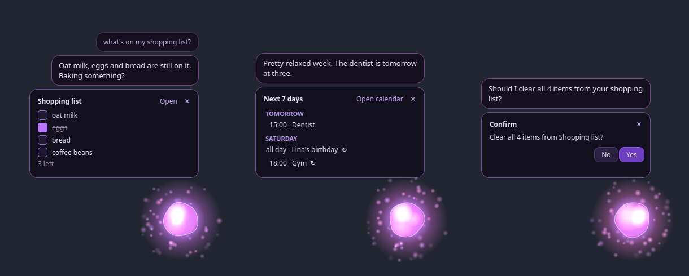

# Aria

Aria ist eine lokale KI-Assistentin für den Schreibtisch: eine leuchtende Kugel in der Bildschirmecke, die zuhört,
spricht, den Laptop steuert und Notizen, Listen und Kalender in **[MyNotion](https://github.com/ibolawand/MyNotion)**
(meiner Notiz-App) führt. Alles läuft lokal auf dem eigenen Rechner: Sprachmodell, Sprache, Kamera.


Sie ist als Freundin gedacht, nicht nur als Werkzeug: Sie fängt selbst Gespräche an, fragt nach, wie die Prüfung
lief, schlägt nach 90 Minuten am Laptop eine Pause vor und merkt sich, was man ihr erzählt. Was sie über einen weiß,
steht in einer Notiz in MyNotion, die man selbst bearbeiten kann.



## Was Aria kann

Die vollständige Liste mit allen Details steht in **[BetterAI/FEATURES.md](BetterAI/FEATURES.md)** (Englisch). Kurz:

| Bereich | Beispiele |
|---|---|
| **Gespräche** | Warme, lockere Persönlichkeit; startet selbst Gespräche (Smalltalk, Nachfragen zu Prüfungen oder Terminen, Pausen, Wochenrückblick am Sonntag) und hält sich bei Filmen, Anrufen und Fokuszeiten zurück |
| **Notizen, Listen, Kalender** | „Schreib Eier auf die Einkaufsliste", „ich habe die Miete bezahlt" (hakt ab), „was habe ich morgen?", „Fitness jeden Montag und Donnerstag um 18 Uhr", „öffne meinen Kalender" |
| **Erinnerungen** | „Erinnere mich jeden Tag um 8 an die Vitamine", „am Montag um 10 ans Zugticket" |
| **Laptop** | Jede App aus dem Menü öffnen, Lautstärke und Audioausgang, Medien, WLAN/Bluetooth, Sperren, Akku und Temperaturen |
| **Dateien** | Nach Namen *und* Inhalt suchen („das PDF über Zahnradgetriebe"), vorlesen, zusammenfassen und als Notiz speichern, Downloads aufräumen |
| **Bildschirm & Kamera** | „Was ist das für ein Fehler auf meinem Bildschirm?", Gesichter erkennen, merken, wann man am Platz ist |
| **Wissen** | Websuche über Wikipedia (und Brave Search mit eigenem Schlüssel) |
| **Musik** | Spotify: Lieder, Künstler, Playlists, Genres |

Riskante Aktionen (Apps schließen, Herunterfahren, Termine löschen …) fragen immer erst nach, und das „Ja" wird im
Code geprüft, nicht vom Sprachmodell. Das Modell bekommt nie eine Shell.

## Aufbau

```
Sprache (faster-whisper) ─┐                    ┌─ Stimme (Kokoro, CPU)
Text (Overlay, Hotkey) ───┼─► main.py ─► Ollama qwen3:8b mit Tool-Calling ─► Tools (Engines/…)
Kamera (OpenCV) ──────────┘      │                                             ├─ NotionEngine ─► MyNotion-SQLite
                                 ├─ Initiative: startet Gespräche              ├─ LaptopEngine, FilesEngine
                                 ├─ Activity: App im Vordergrund (nur im RAM)  ├─ Reminders, FocusMode
                                 └─ Gedächtnis: aria_memory.db + MyNotion-Notiz └─ WebSearch, ScreenEngine
```

Das Overlay (`BetterAI/ui/overlay.py`) ist ein durchsichtiges PySide6-Fenster; Aria selbst läuft in einem eigenen Thread.

## Installation (Linux Mint / Cinnamon)

Voraussetzungen: Python 3.12, [Ollama](https://ollama.com), eine Grafikkarte mit ~8 GB (getestet mit einer RTX 4070).

```bash
ollama pull qwen3:8b
ollama pull qwen2.5vl:7b                      # nur für Bildschirm und Kamera
sudo apt install wmctrl x11-utils poppler-utils playerctl lm-sensors

cd BetterAI
python3 -m venv .venv
.venv/bin/pip install -r requirements.txt
./install_desktop.sh                          # Menüeintrag, Autostart, Hotkey Strg+Alt+Leertaste
```

Einstellungen kommen in `BetterAI/Engines/.env` (wird nicht eingecheckt), zum Beispiel:

```ini
DB_PATH=/home/<du>/.config/MyNotion/noted.db  # MyNotion-Datenbank
SPOTIFY_CLIENT_ID=...                         # optional
SPOTIFY_CLIENT_SECRET=...
BRAVE_API_KEY=...                             # optional: Websuche für Aktuelles
ARIA_QUIET=22:30-08:30                        # Ruhezeiten
```

Alle Einstellungen sind in [FEATURES.md](BetterAI/FEATURES.md) beschrieben.

## Benutzen

- **Strg+Alt+Leertaste** öffnet das Textfeld (startet Aria, falls sie nicht läuft).
- `python main.py --voice` mit Aktivierungswort und Mikrofon, `--no-ui` nur im Terminal.
- `./aria.sh --quit` beendet Aria; `./aria.sh --chat` lässt sie sofort ein Gespräch anfangen (auch `--followup`, `--break`, `--review`).
- Rechtsklick auf die Kugel: schlafen, stumm, Gesprächsstarter an/aus.

## Tests

```bash
cd BetterAI
.venv/bin/pip install -r requirements-dev.txt
.venv/bin/python -m pytest
```

96 Tests in etwa 7 Sekunden. Sie brauchen weder Sprachmodell noch Kamera, Mikrofon oder Internet,
arbeiten nur mit temporären Datenbanken und schlagen fehl, falls ein Test die echten Daten öffnen will.

## Datenschutz

- Sprachmodell, Spracherkennung, Stimme und Kamera laufen lokal. Ins Internet gehen nur die Websuche und Spotify.
- Was Aria über einen weiß, steht in der Notiz „What Aria knows about me" in MyNotion: Zeile löschen = vergessen.
- Welche App im Vordergrund ist, wird nur im Arbeitsspeicher gehalten und nie gespeichert.
